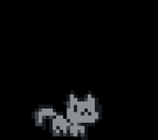

### hey, i'm ramsha!

**software engineer · backend & AI agents**

i build things that make complicated systems a little less complicated.

most days, that means working with **AI agents and backend systems**.

i like understanding how things work, whether that's the thought behind a well-designed system, an LLM's reasoning, or the questionable decisions of a dostoevsky protagonist.

**currently interested in:** AI agents, backend engineering, automation, and building things that are genuinely useful.

---

### `~/what-i-do`

- 💻 **backend engineering** — Java, Quarkus, Python
- 🧠 **AI & agentic systems** — LLMs, tool calling, orchestration, evaluation and observability
- 🗄️ **data & infrastructure** — PostgreSQL, MongoDB, Google Cloud
- ⚒️ **developer tooling** — workflow automation, integrations and bots
- ⭐️ **occasionally switching syntax** — Javascript when the problem calls for it
- 🧩 **always learning** — currently curious about design patterns, and the engineering decisions behind great software

i care about the unglamorous bits, too ~ failure analysis, observability, edge cases, maintainability, and figuring out why something broke at 2 pm instead of 2 am.

---

### `~/outside-the-terminal`

🍜 hopped up on iced coffee and ramen.

📚 reading franz kafka and fyodor dostoevsky because apparently regular overthinking wasn't enough.

🎬 romcom enthusiast. dad-joke appreciator. ferrari comeback believer. the comeback is coming. any day now. probably.

🐈 cat person. no further elaboration necessary.

---

### `~/connect`

 [LinkedIn](https://www.linkedin.com/ramsha-ashraf) [Twitter/X](https://x.com/ramshaashraf777)

made with curiosity, caffeine, and an unreasonable number of browser tabs.

  

